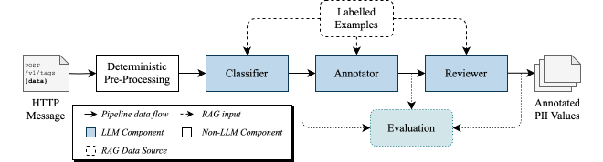
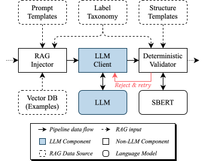

# HTTP PII Annotator

Taxonomy-agnostic annotation of PII values in HTTP traffic using LLMs.

This repository contains the annotation pipeline, the synthetic traffic generator, the label taxonomies, the synthetic datasets and the evaluation results of the paper

> Thomas Cory and Axel Küpper. **Addressing Labelled Data Scarcity: Taxonomy-Agnostic Annotation of PII Values in HTTP Traffic using LLMs.**

The pipeline identifies explicitly transmitted values of personally identifiable information (PII) in the bodies of HTTP messages and labels them with the data types of a taxonomy that is provided at runtime. Switching to a different taxonomy requires neither retraining nor code changes, only a Markdown table of labels and, optionally, a pool of annotated examples.

## Pipeline



| Step | Task | Description |
|---|---|---|
| Pre-processing | – | Normalises message bodies by decoding URL-encoded characters, HTML character references and, optionally, Base64-encoded substrings. The original body is kept. |
| Classification | `classify` | Label-level: an LLM predicts which data types of the taxonomy occur in the body. |
| Targeted annotation | `targeted_annotate` | Instance-level: an LLM extracts the values of the predicted data types. |
| Review | `review` | An LLM receives the body and the annotations and adds, corrects or removes annotations. |

Every LLM step is wrapped by the same harness:



- **Retrieval-augmented prompts.** Each prompt contains the system prompt of the task, the taxonomy and annotated examples retrieved from an example pool: the examples with the most similar payloads and, for annotation and review, a minimal set of examples that covers all labels predicted for the message.
- **Output validation.** A verifier checks the structure of every response and maps labels that are not part of the taxonomy to the most similar valid label. If no valid label is similar enough, the label is rejected: the model is told which labels are not part of the taxonomy and asked again, and what is still rejected after that is discarded.

Instead of the two-stage procedure (classification followed by targeted annotation), the pipeline can annotate messages in a single stage (`annotate` task), or run both variants side by side for an ablation study. If the input messages carry ground-truth annotations, the output of every LLM step is evaluated at label level and at instance level.

## Repository layout

```
http_pii_annotator/            the annotation pipeline
  main.py                        command line interface: python http_pii_annotator/main.py
  requirements.txt               dependencies
  config-example.json            example of a configuration file
  src/
    config.py                      configuration
    pipeline.py                    definition of the checkpoints and modes
    executor.py                    runs the steps: concurrency, retries, resuming, evaluation
    pipeline_steps/                pre-processor and the four LLM steps
    harness.py                     inference harness: retrieve examples -> prompt -> model -> validate
    prompts.py, prompts/           prompt assembly; system prompts and response schemas per task
    retrieval.py                   retrieval of examples (RAG)
    validation.py                  validation of the model output
    llm_connectors/                API connectors
    evaluation/                    metrics, matching with ground truth, reports
    taxonomies/                    label taxonomies (ai4privacy, mhealth, playstore)
synthetic_traffic_generator/   the generator of synthetic HTTP messages
  main.py                        command line interface: python synthetic_traffic_generator/main.py
  requirements.txt               dependencies
  src/
    executor.py                    runs the steps
    pipeline_steps/                generation and validation of scenarios, requests and responses; encoding
    prompts/                       system and user prompts per step
    llm.py                         model client of a run: conversation, response log, request options
    llm_connectors/                API connectors (the same files as the annotator's)
    taxonomies/                    label taxonomies (the same three) and the labels that are never generated
figures/                       the figures of the paper
data/
  README.md                      the result tables of the paper and notes on the runs
  scenarios/<taxonomy>/          scenario set and synthetic HTTP requests with ground-truth PII annotations
  annotations/<taxonomy>/        output of every pipeline step in the runs of the paper, with the evaluation reports
```

## Setup

Python 3.12 or newer is required.

```bash
python -m venv .venv
source .venv/bin/activate
python -m pip install -r http_pii_annotator/requirements.txt
```

The pipeline is run with `python http_pii_annotator/main.py`, from the root of the repository so that the paths under `data/` in the examples below resolve. The first run downloads the sentence embedding model `all-MiniLM-L6-v2`, which is used for example retrieval and label correction.

API keys are read from the `.env` file in the root of the repository, which the generator reads as well. Copy `.env.example` to `.env` and set the key of the provider you use (`OPENAI_API_KEY`, `ANTHROPIC_API_KEY` or `DEEPSEEK_API_KEY`). No key is needed for an OpenAI-compatible endpoint that is selected with `-hostname`, such as a llama.cpp server. For Ollama, `OLLAMA_HOSTNAME` sets the server URL (unless `-hostname` is given) and `OLLAMA_API_KEY` is only needed if the server requires a bearer token; Ollama's own API is selected with `-api ollama`. Never commit the `.env` file.

## Usage

Annotate the PlayStore evaluation set with a model served by a local llama.cpp server and compare the result to the ground truth:

```bash
python http_pii_annotator/main.py -run-id demo -schema playstore -input data/scenarios/playstore/eval.jsonl \
    -model unsloth/Qwen3.5-397B-A17B-GGUF:Q4_K_M -hostname http://localhost:8080/v1
```

The same with a hosted model and four concurrent requests, annotating your own messages without example retrieval:

```bash
python http_pii_annotator/main.py -run-id my-traffic -schema my-taxonomy.md -input my-messages.jsonl \
    -model gpt-4.1-mini-2025-04-14 -no-rag -concurrency 4
```

Each run writes to `<root-dir>/<run-id>/` (default `./output/<run-id>/`).

**Resuming.** Running the same command again continues the run: results that already exist are kept, and only messages that are missing, that failed, or whose input has changed are processed. An interrupted run therefore loses at most the requests that were in flight. Changes of the model, the taxonomy or the example pool are not detected; use `-restart` to discard the existing output.

**Failures.** A failed request is repeated `-max-retries` times with increasing delays. If it still fails, the message is written with an empty result and an `error` field, and the run continues; the next run retries it. A step is aborted if five messages in a row fail, which indicates a problem that affects all requests, such as invalid credentials.

### Arguments

| Argument | Description |
|---|---|
| `-run-id ID` | Unique identifier of the run (required). |
| `-schema NAME\|PATH` | Label taxonomy: name of a bundled taxonomy or path to a Markdown taxonomy file (required). |
| `-input PATH` | JSON/JSONL file or folder with the HTTP messages. Default: `<root-dir>/<run-id>/input`. |
| `-input-encoding ENCODING` | Character encoding of the input files. Default: `utf-8`. |
| `-root-dir PATH` | Folder in which run folders are created. Default: `./output`. |
| `-model MODEL` | Default model for all LLM steps. |
| `-model-classify`, `-model-annotate`, `-model-targeted-annotate`, `-model-review` | Model for a single LLM step. |
| `-api {openai,anthropic,deepseek,ollama}` | API that serves the model(s). Default: `openai`, which also works with any OpenAI-compatible endpoint given with `-hostname`. |
| `-hostname URL` | Base URL of the API endpoint, e.g. of a llama.cpp or Ollama server. |
| `-keep-model-loaded` | Do not unload locally hosted models (Ollama) at the end of the run. |
| `-mode {two-stage,single-stage,ablation}` | `two-stage` (default): classification and targeted annotation. `single-stage`: direct annotation. `ablation`: both. Review follows in these modes. |
| `-normalization {paper,strict}` | Pre-processing of the bodies: `paper` (default) as evaluated in the paper, `strict` without its side effects (see "Differences from the paper"). |
| `-decode-base64` | Also decode substrings of the bodies that match a conservative Base64 pattern and decode to predominantly printable UTF-8 text. Off by default, as in the runs of the paper. |
| `-skip-preprocess`, `-skip-classify`, `-skip-annotate`, `-skip-review` | Do not run a step; subsequent steps use its existing output. |
| `-skip-evaluate` | Skip the comparison with ground-truth annotations. |
| `-eval` | Only evaluate the existing output of a previous run. |
| `-restart` | Discard the existing output of the run instead of resuming it. |
| `-concurrency N` | Number of messages that an LLM step processes at the same time. Default: 1. |
| `-max-retries N` | Number of times a failed request is repeated. Default: 3. |
| `-request-timeout SECONDS` | Abort a request after this time. Default: wait indefinitely. |
| `-no-rag` | Do not add retrieved examples to the prompts. |
| `-examples PATH` | JSONL file with annotated example messages. Default: `data/scenarios/<schema>/examples.jsonl`. |
| `-max-examples N` | Number of examples retrieved by payload similarity. Default: 3. |
| `-min-example-similarity FLOAT` | Minimum cosine similarity of examples retrieved by payload similarity. Default: 0.3. |
| `-min-label-similarity FLOAT` | Cosine similarity that the closest valid label must reach for a label outside the taxonomy to be replaced by it; below it, the label and its annotation are rejected. Default: 0.4. `-1` never rejects. |
| `-max-label-requeries N` | Number of times the model is asked again after a response with rejected labels, before these are discarded. Default: 1. |
| `-verbose` | Log the LLM responses and the evaluation metrics per label. |
| `-quiet` | Only log warnings and errors. |
| `--config PATH` | JSON configuration file, see `http_pii_annotator/config-example.json`. Command line arguments override its values. |

### Models and APIs

The model name given with `-model` is passed on unchanged to the API selected with `-api`. The default API is `openai`; with `-hostname` it reaches any server that implements the OpenAI API, such as llama.cpp, vLLM or Ollama. For Anthropic, DeepSeek or Ollama's own API, pass `-api` as well.

The results in the paper were produced with the OpenAI-compatible connector and a llama.cpp server. The Anthropic, DeepSeek and Ollama connectors send the same prompts but were not part of the evaluation. Only the OpenAI-compatible and Ollama connectors enforce the JSON response schema of a task; the DeepSeek connector requests a JSON object and the Anthropic connector plain text, so for these two the schema is described in the system prompt only.

With `-concurrency` greater than 1, a local server only gains speed if it is configured to process requests in parallel (e.g. `--parallel` for llama.cpp, `OLLAMA_NUM_PARALLEL` for Ollama).

### Input

Messages are read from a JSONL file (one message per line), a JSON file containing an array of messages, or all such files in a folder (in alphabetical order). A message is an object with a `body` string; all other fields are passed through:

```json
{"method": "POST", "path": "/api/v1/signup", "body": "{\"firstName\":\"Marcus\",\"email\":\"marcus.wellington@example.com\"}"}
```

For evaluation, a message is wrapped together with its ground truth. Only annotations with `"placement": "body"` are used as ground truth:

```json
{
  "id": "req_001",
  "scenario": "signup_account_creation",
  "http_request": {"method": "POST", "path": "/api/v1/signup", "body": "..."},
  "pii_annotations": [{"data_type": "Name", "placement": "body", "value": "Marcus"}],
  "data_types_present": ["Name"]
}
```

### Output

```
<root-dir>/<run-id>/
├── output/
│   ├── 1_preprocessed/            preprocessed.jsonl
│   ├── 2_classified/              classified.jsonl, verified.jsonl      (two-stage)
│   ├── 3_annotated_single_stage/  annotated.jsonl, verified.jsonl       (single-stage)
│   ├── 4_annotated_two_stage/     annotated.jsonl, verified.jsonl       (two-stage)
│   ├── 5_reviewed_single_stage/   reviewed.jsonl, verified.jsonl        (single-stage)
│   ├── 6_reviewed_two_stage/      reviewed.jsonl, verified.jsonl        (two-stage)
│   └── evaluation/                evaluation_report_<checkpoint>.json, false_negatives_<checkpoint>.json
└── log/                           raw LLM responses and processing times
```

For each LLM step, the first file holds the result as returned by the model and `verified.jsonl` the validated result. The final result of the default mode is `6_reviewed_two_stage/verified.jsonl`, in which every message carries its annotations. `message_id` identifies a message in all files of a run; it consists of the position of the message in the input and, if present, its `id`.

```json
{"message_id": "000000_req_001", "method": "POST", "path": "/api/v1/signup", "body": "...",
 "original_body": "...",
 "predicted_labels": ["Name", "Email address"],
 "annotations": [{"data_type": "Name", "value": "Marcus"}, {"data_type": "Email address", "value": "marcus.wellington@example.com"}],
 "original_annotations": [{"data_type": "Name", "value": "Marcus", "start": 14, "end": 20},
                          {"data_type": "Email address", "value": "marcus.wellington%40example.com", "start": 30, "end": 61}]}
```

`body` is the normalised body, to which the values in `annotations` refer, and `original_body` the body as it was received. `original_annotations` maps the annotations back to the original body: one entry per occurrence of an annotated value, with the text it has there and its position (`start` inclusive, `end` exclusive). A value that was decoded from Base64 is reported as the encoded substring that contains it; a value that does not occur in the body has no position.

## Taxonomies

A taxonomy is a Markdown table with a column named `PII Data type`, which contains the labels. All other columns (categories, descriptions, examples) are free-form; the complete table is included in the prompts.

| Taxonomy | Labels | Source |
|---|---|---|
| `ai4privacy` | 51 | Label set of the [AI4Privacy pii-masking-200k](https://huggingface.co/datasets/ai4privacy/pii-masking-200k) dataset as applied by Mainetti and Elia (2025) |
| `mhealth` | 38 | Protected health information scheme for mHealth apps by Cory et al. (2024) |
| `playstore` | 38 | Data types of the [Google Play Data safety section](https://support.google.com/googleplay/android-developer/answer/10787469) |

The taxonomies are in `http_pii_annotator/src/taxonomies/`. To use your own taxonomy, pass the path of its Markdown file with `-schema`. To support it with examples, pass a JSONL file of annotated messages in the format shown above with `-examples`, or run without examples using `-no-rag`.

## Datasets

`data/scenarios/<taxonomy>/` contains synthetic HTTP requests with ground-truth PII annotations for each taxonomy. They were created with the synthetic HTTP message generator presented in the paper and validated manually.

| File | Content |
|---|---|
| `scenarios.json` | The scenario set the requests were generated from. |
| `generation_metadata.json` | Generation settings and validation statistics of each scenario. |
| `eval.jsonl` | Evaluation set (80 %): annotated by the pipeline and compared to the ground truth. |
| `examples.jsonl` | Example set (20 %): pool of annotated examples for the RAG mechanism. |

| Taxonomy | Scenarios | Scenarios with requests | Requests | Evaluation set | Example set |
|---|---|---|---|---|---|
| `ai4privacy` | 35 | 29 | 1142 | 892 | 250 |
| `mhealth` | 25 | 22 | 1008 | 926 | 82 |
| `playstore` | 29 | 26 | 1251 | 982 | 269 |

Every request names its scenario in the field `scenario`, so the two sets together are the complete generator output. The keys of `generation_metadata.json` have the form `S<id>-<count>.jsonl`, where `<count>` is the number of valid requests generated for scenario `<id>`.


The generator is in [synthetic_traffic_generator/](synthetic_traffic_generator/). It has its own dependencies (`synthetic_traffic_generator/requirements.txt`) and, like the annotator, is run from the root of the repository: `python synthetic_traffic_generator/main.py` without arguments lists its options.

## Reproducing the results of the paper

`data/annotations/<taxonomy>/output/` holds the output of every pipeline step in the runs of the paper; its folder `evaluation/` contains the evaluation reports behind Tables 1 and 2. The tables themselves are in [data/README.md](data/README.md).

To recompute the reports from these outputs without calling an LLM:

```bash
python http_pii_annotator/main.py -run-id ai4privacy -root-dir data/annotations -schema ai4privacy -input data/scenarios/ai4privacy/eval.jsonl -mode ablation -eval
python http_pii_annotator/main.py -run-id mhealth    -root-dir data/annotations -schema mhealth    -input data/scenarios/mhealth/eval.jsonl    -mode ablation -eval -input-encoding mac-roman
python http_pii_annotator/main.py -run-id playstore  -root-dir data/annotations -schema playstore  -input data/scenarios/playstore/eval.jsonl  -mode ablation -eval -input-encoding mac-roman
```

The option `-input-encoding mac-roman` reproduces an encoding error of the original runs, which is described in the next section.

To repeat the experiment, run the pipeline in ablation mode for each taxonomy with the model used in the paper:

```bash
python http_pii_annotator/main.py -run-id playstore -schema playstore -input data/scenarios/playstore/eval.jsonl -mode ablation \
    -model unsloth/Qwen3.5-397B-A17B-GGUF:Q4_K_M -hostname <llama.cpp endpoint>
```

LLM output is not deterministic, so the scores of a new run will differ slightly from the reported ones.

## Differences from the paper

The implementation has been continued since publication and thus deviates from the description in the paper in the following points.

- **Side effects of the pre-processing.** As evaluated, the pre-processing decodes every plus sign as a space, also in bodies that are not form-encoded, and decodes character references that lack their semicolon. The international prefix of a phone number in a JSON document therefore loses its plus sign, and `&timestamp=` in a form-encoded body becomes `×tamp=`. This alters 15 % of the AI4Privacy, 6 % of the mHealth and 21 % of the PlayStore bodies, and 3.3 %, 0.1 % and 6.3 % of their ground-truth values no longer occur verbatim in the pre-processed body, which lowers the reported instance-level scores. `-normalization strict` avoids both effects; the default `paper` reproduces the evaluated behaviour.
- **Input encoding.** In the runs reported in the paper, the character encoding of the input files was detected automatically, and the evaluation sets of mHealth and PlayStore, which are encoded in UTF-8, were read as MacRoman. All characters outside ASCII in the message bodies of these two sets were therefore replaced by other characters before the messages reached the model (for example `2400×1080` became `2400√ó1080`). This concerns 140 of the 926 mHealth messages and 49 of the 982 PlayStore messages. The ground truth was read in the same way, so predictions and ground truth were compared consistently, and AI4Privacy was read correctly. The pipeline now reads input as UTF-8 unless `-input-encoding` says otherwise; results of new runs on these two sets are therefore not exactly comparable to the reported ones.

## Citation

```bibtex
@INPROCEEDINGS{11631901,
  author={Cory, Thomas and Küpper, Axel},
  booktitle={2026 IEEE European Symposium on Security and Privacy Workshops (EuroS&PW)}, 
  title={Addressing Labelled Data Scarcity: Taxonomy-Agnostic Annotation of PII Values in HTTP Traffic using LLMs}, 
  year={2026},
  pages={6-19},
  keywords={Annotations;Labeling;Modeling;Taxonomy;Pipelines;Electronic mail;Large language models;Privacy;HTTP;Printing;pii;annotation;llm;synthetic data generation},
  doi={10.1109/EuroSPW72509.2026.00009}}
```

## License

This project is licensed under [GPLv3](LICENSE).

## Acknowledgments

This project is developed at the [Service-centric Networking](https://www.tu.berlin/snet) chair of Technische Universität Berlin. The pipeline architecture is based on the annotation pipeline for privacy policies presented in *Word-level Annotation of GDPR Transparency Compliance in Privacy Policies using Large Language Models* (Cory et al., PoPETs 2026).
